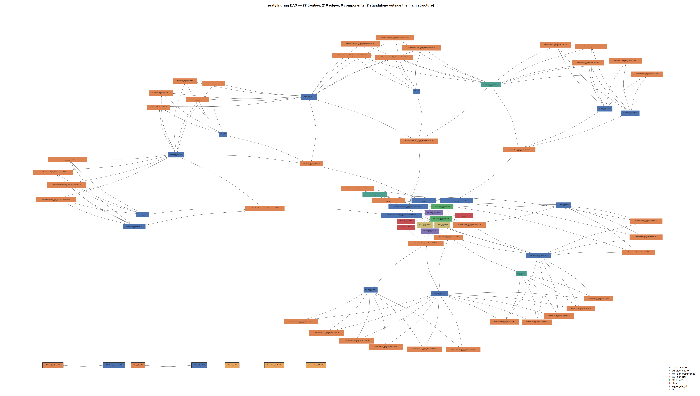
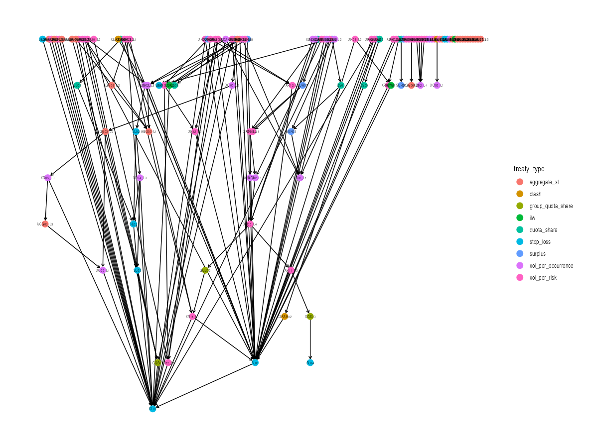

```{r knit_opts}
#| include: false

library(conflicted)
library(tidyverse)
library(magrittr)
library(rlang)
library(glue)
library(scales)
library(cowplot)
library(gt)
library(DiagrammeR)
library(igraph)
library(ggraph)
library(tidygraph)
library(arrow)


source("lib_utils.R")
source("lib_treaties.R")


conflict_lst <- resolve_conflicts(
  c("xml2", "magrittr", "rlang", "dplyr", "readr", "purrr", "ggplot2")
  )


options(
  width = 80L,
  warn  = 1,
  mc.cores = parallel::detectCores()
  )


theme_set(theme_cowplot())
```


```{r set_up_inuring_graph_loss_data}
#| echo: false

loss_events_tbl <- read_csv("demo_business/loss_events.csv")
loss_allocation_tbl <- read_csv("demo_business/loss_allocation_walkthrough.csv")

graph_nodes_tbl <- read_parquet("demo_business/nodes_tbl.parquet")
graph_edges_tbl <- read_parquet("demo_business/edges_tbl.parquet")


inuring_tblgraph <- build_inuring_tblgraph(graph_nodes_tbl, graph_edges_tbl)
```


```{r set_up_basics_examples}
#| echo: false

qs_cession <- 0.37

qs_tbl <- tibble(gross_loss = c(2e6, 10e6, 40e6)) |>
  mutate(
    ceded = qs_recovery(gross_loss, qs_cession),
    net   = gross_loss - ceded
    )

tower_loss <- 14e6

tower_tbl <- tibble(
  layer      = c("L1", "L2"),
  attachment = c(5e6, 10e6),
  limit      = c(5e6, 10e6)
  )

tower_recovery_tbl <- tower_recoveries(tower_loss, tower_tbl) |>
  transmute(
    layer,
    band     = glue("{fmt_m(limit)} xs {fmt_m(attachment)}"),
    recovery
    )

tower_retained <- tower_loss - sum(tower_recovery_tbl$recovery)

tower_display_tbl <- bind_rows(
  tibble(
    layer    = "Retained",
    band     = glue("Below {fmt_m(min(tower_tbl$attachment))}"),
    recovery = tower_retained
    ),
  tower_recovery_tbl
  )

period_loss_vec <- c(8e6, 9e6, 10e6)
layer_attach    <- 5e6
layer_limit     <- 5e6
n_reinstate     <- 1

period_tbl <- tibble(
  event_loss    = period_loss_vec,
  occurrence    = period_recoveries(period_loss_vec, layer_attach, layer_limit),
  reinstatement = period_recoveries(
    period_loss_vec, layer_attach, layer_limit,
    cap = layer_limit * (1 + n_reinstate)
    ),
  aggregate     = period_recoveries(
    period_loss_vec, layer_attach, layer_limit,
    cap = layer_limit
    )
  )

order_loss    <- 10e6
order_cession <- 0.30

order_qs  <- \(x) qs_recovery(x, order_cession)
order_xol <- \(x) xol_recovery(x, attachment = 5e6, limit = 5e6)

order_tbl <- tibble(
  sequence = c("QS then XoL", "XoL then QS"),
  result   = list(
    apply_in_order(order_loss, list(order_qs, order_xol)),
    apply_in_order(order_loss, list(order_xol, order_qs))
    )
  ) |>
  mutate(
    first_ceded  = map_dbl(result, \(r) r$ceded[1]),
    second_ceded = map_dbl(result, \(r) r$ceded[2]),
    total_ceded  = first_ceded + second_ceded,
    net          = map_dbl(result, "subject")
    )
```


```{r set_up_synthetic_data}
#| echo: false

synth_dir <- "data_synthreins"

synth_treaties_tbl <- read_csv(glue("{synth_dir}/treaties.csv"), show_col_types = FALSE)
synth_nodes_tbl    <- read_parquet(glue("{synth_dir}/nodes_tbl.parquet"))
synth_edges_tbl    <- read_parquet(glue("{synth_dir}/edges_tbl.parquet"))
synth_events_tbl   <- read_csv(glue("{synth_dir}/loss_events.csv"), show_col_types = FALSE)
synth_walk_tbl     <- read_csv(glue("{synth_dir}/loss_allocation_walkthrough.csv"), show_col_types = FALSE)

read_stats <- function(path) {
  read_csv(path, show_col_types = FALSE) |>
    deframe() |>
    as.list()
}

synth_stats_lst <- read_stats(glue("{synth_dir}/graph_stats.csv"))
synth_p2_lst    <- read_stats(glue("{synth_dir}/phase2_stats.csv"))
mega_stats_lst  <- read_stats(glue("{synth_dir}/realistic_mega/stats.csv"))

synth_n_periods <- nrow(read_csv(glue("{synth_dir}/raw/phase2_mid_seed43/period_df.csv"), show_col_types = FALSE))

synth_tblgraph <- build_inuring_tblgraph(synth_nodes_tbl, synth_edges_tbl)

mega_caption <- glue(
  "{mega_stats_lst$treaties} treaties, {mega_stats_lst$edges} inuring edges, ",
  "{mega_stats_lst$isolated} isolated; up to {mega_stats_lst$max_parents} parents on one treaty"
  )
```


# Reinsurance Basics

\

Cedants transfer part of their risk (and premium) to reinsurers

\

Capacity, volatility, capital

\

$$
\text{Gross loss} = \text{Ceded} + \text{Net retained}
$$

---

### Quota Share (QS)

\

Proportional: the same share of every loss (and of premium)

\

::: {.custom-medium}
```{r show_qs_example}
#| echo: false

qs_tbl |>
  transmute(
    `Gross loss`       = fmt_m(gross_loss),
    `Ceded (recovery)` = fmt_m(ceded),
    `Net retained`     = fmt_m(net)
    ) |>
  knitr::kable(align = "rrr")
```
:::

\

`r percent(qs_cession)` QS. Surplus: proportional, share varies with risk size

---

### Excess of Loss (XoL)

\

Non-proportional: pays the part of a loss above the attachment, up to the limit

\

A `r fmt_m(tower_loss)` loss through a two-layer tower

::: {.custom-medium}
```{r show_tower_example}
#| echo: false

tower_display_tbl |>
  transmute(Layer = layer, Band = band, Recovery = fmt_m(recovery)) |>
  knitr::kable(align = "llr")
```
:::

\

Per-risk: one risk's loss. Per-occurrence: one event's total across risks

---

Occurrence limit: most paid for any one event

\

Aggregate limit: most paid across all events in the period

\

Reinstatement: limit restored, usually for extra premium

\

Capacity = limit $\times$ (1 + reinstatements)

---

::: {.custom-medium}
```{r show_period_example}
#| echo: false

period_tbl |>
  bind_rows(summarise(period_tbl, across(everything(), sum))) |>
  transmute(
    Event = c(glue("Event {1:3}"), "Total"),
    `Event loss` = fmt_m(event_loss),
    `Occurrence limit only` = fmt_m(occurrence),
    `One reinstatement` = fmt_m(reinstatement),
    `Aggregate limit` = fmt_m(aggregate)
    ) |>
  knitr::kable(align = "lrrrr")
```
:::

\

`r fmt_m(layer_limit)` xs `r fmt_m(layer_attach)`: only the cap differs

---

### Order Matters

\

Each treaty changes the loss the next one sees

\

::: {.custom-medium}
```{r show_order_example}
#| echo: false

order_tbl |>
  transmute(
    Sequence = sequence,
    `First treaty` = fmt_m(first_ceded),
    `Second treaty` = fmt_m(second_ceded),
    `Total ceded` = fmt_m(total_ceded),
    `Net retained` = fmt_m(net)
    ) |>
  knitr::kable(align = "lrrrr")
```
:::

\

`r fmt_m(order_loss)` loss, `r percent(order_cession)` QS and `r fmt_m(layer_limit)` xs `r fmt_m(layer_attach)`

\

Sequence is a graph


# The Problem

---

::: {.custom-medium}
```{r show_loss_events}
#| echo: false

loss_events_tbl |>
  transmute(
    event_id, description, gross_loss = scales::label_currency()(gross_loss)
    ) |>
  knitr::kable(align = "llr")
```
:::

---

Who pays what?

---



---

### What real portfolios look like

{height=480}

`r mega_caption`

---

Hand-drawn diagrams do not scale

\

Code, iteration and a sensible plan

---

How to allocate losses across treaties?


# Treaties as Functions

---

$$
Treaty: \text{Losses} \rightarrow \text{Recoveries}
$$

---

Quota Share (QS)

\


Excess of Loss (XoL)

\


Aggregate / Occurrence Limits


## Recovery Accounting


---

### 10XS10 XoL

\


10 million excess of 10 million

---

| Segment      | Gross Loss |
|--------------|-----------:|
| Construction |       5.0M |
| Legal        |      10.0M |
| I.T.         |       5.0M |
|              |            |
| Total        |      20.0M |


---

Treaty recovers 10M

---

How do we allocate them?

---

| Segment      | Treaty  | Recovery |
|--------------|---------|---------:|
| Construction | 10XS10  |     2.5M |
| Legal        | 10XS10  |     5.0M |
| I.T.         | 10XS10  |     2.5M |
|              |         |          |
| Total        | 10XS10  |    10.0M |


---

### 25% QS

\


25% quota-share (often with a limit)

---

| Segment      | Gross Loss |
|--------------|-----------:|
| Construction |       5.0M |
| Legal        |      10.0M |
| I.T.         |       5.0M |
|              |            |
| Total        |      20.0M |


---

Treaty recovers 5M

---


| Segment      | Treaty  | Recovery |
|--------------|---------|---------:|
| Construction | 25% QS  |    1.25M |
| Legal        | 25% QS  |    2.50M |
| I.T.         | 25% QS  |    1.25M |
|              |         |          |
| Total        | 25% QS  |    5.00M |


# Inuring

---

Sequencing of treaties


## Gross / Subject Losses

---

Subject Loss = Gross Loss - Inuring Recoveries

---

```{r show single_node_connected}
#| echo: false

target_node <- "XOL02_L1"  # node name/value to match

node_id <- inuring_tblgraph |>
  activate(nodes) |>
  as_tibble() |>
  mutate(row_id = row_number()) |>
  filter(treaty_id == target_node) |>
  pull(row_id)

treaty_subgraph <- inuring_tblgraph |>
  convert(
    to_local_neighborhood,
    node  = node_id,
    order = 1,
    mode  = "in"
    )

treaty_subgraph |>
  ggraph(layout = "stress") +
  geom_edge_link(arrow = arrow(length = unit(3, "mm")), end_cap = circle(3, "mm")) +
  geom_node_label(aes(label = treaty_id)) +
  theme_graph()
```


## Topological Sort


---

Inuring graph dictates calculation order

---

```{r show_full_graph}
#| echo: false

graph_layout <- inuring_tblgraph |> igraph::layout_with_fr()

ggraph(inuring_tblgraph, layout = graph_layout) +
  geom_edge_link(
    arrow  = arrow(angle = 14, type = "closed"),
    colour = "darkgrey"
    ) +
  geom_node_label(
    aes(label = treaty_id),
    size  = 2,
    repel = FALSE
    ) +
  scale_x_continuous(expand = expansion(0.03)) +
  theme_graph()

```

---

::: {.custom-small}
```{r show_inuring_sort}
#| echo: false

topo_order <- inuring_tblgraph |>
  igraph::topo_sort(mode = "out")

inuring_tblgraph |>
  activate(nodes) |>
  as_tibble() |>
  slice(as.integer(topo_order)) |>
  transmute(
    calc_order = row_number(),
    treaty_id, treaty_type, treaty_label, description
    ) |>
  head(15) |>
  knitr::kable()

```
:::


# Orchestration

---


::: {.custom-small}
```
1. Construct graph
2. Construct treaty functions
3. Determine treaty/loss coverage
4. Topological sort
5. Loop over each node:

    a. List inuring treaties
    b. List inuring losses/recoveries
    c. Keep covered losses/recoveries
    d. Calculate subject losses
    e. Calculate recoveries

6. Gather all per-node outputs
7. Construct outputs
```
:::

---

Treaty / Loss coverage non-trivial

---

Multiple ways to determine coverage

\


Many-to-many relationship

---

Gross / net premium losses

\


Organisation unit

\


Regulatory authority


# Synthetic Portfolios

\

No real programme to show

\

Generate one instead: deterministic given seed and tier

---

### Two Phases

\

Phase 1: structure

Treaties, inuring edges, premiums, exposure, needs, coverage

\

Phase 2: simulation

Periods, events, losses, per-treaty flows

\

Rate-on-line, attachments and limits are structurally derived, not actuarial

---

::: {.custom-medium}
```{r show_tier_table}
#| echo: false

tier_tbl <- tibble(
  Portfolio       = c("Mid tier, seed 43", "Mega tier, seed 2003"),
  Phase           = c("1 and 2", "1 only"),
  Treaties        = c(synth_stats_lst$treaties, mega_stats_lst$treaties),
  Connected       = c(synth_stats_lst$connected, mega_stats_lst$connected),
  Edges           = c(synth_stats_lst$edges, mega_stats_lst$edges),
  `Longest path`  = c(synth_stats_lst$longest_path_edges, mega_stats_lst$longest_path_edges),
  `Max parents`   = c(synth_stats_lst$max_parents, mega_stats_lst$max_parents),
  `Cross-scope`   = c(synth_stats_lst$cross_scope_edges, mega_stats_lst$cross_scope_edges)
  )

tier_tbl |>
  knitr::kable(align = "llrrrrrr")
```
:::

\

Tiers set the scale: the mid-tier run has `r synth_p2_lst$events` events over `r synth_n_periods` periods

---

### A Legible Portfolio

```{r show_synth_dag}
#| echo: false
#| fig-width: 11
#| fig-height: 6
#| fig-align: center

synth_layout <- layout_packed_components(synth_tblgraph, max_width = 18)

plot_inuring_dag(synth_tblgraph, synth_layout, label_col = "treaty_id", label_size = 2.6)
```

---

::: {.custom-medium}
```{r show_synth_type_mix}
#| echo: false

synth_treaties_tbl |>
  summarise(
    treaties  = n(),
    connected = sum(treaty_id %in% synth_nodes_tbl$treaty_id),
    .by = treaty_type
    ) |>
  arrange(desc(treaties)) |>
  rename(`Treaty type` = treaty_type, Treaties = treaties, Connected = connected) |>
  knitr::kable(align = "lrr")
```
:::

\

`r synth_stats_lst$connected` connected treaties in `r synth_stats_lst$components` components

\

Longest path `r synth_stats_lst$longest_path_edges` edges, `r synth_stats_lst$multi_parent_nodes` multi-parent treaties


```{r run_functional_recompute}
#| echo: false

raw_dir <- glue("{synth_dir}/raw/phase2_mid_seed43")

raw_names <- c(
  "treaty_df", "coverage_df", "lob_df", "loss_df", "event_df", "period_df",
  "flow_df", "treaty_period_df"
  )

raw_lst <- setNames(raw_names, raw_names) |>
  map(\(nm) read_csv(glue("{raw_dir}/{nm}.csv"), show_col_types = FALSE, progress = FALSE))

invisible(list2env(raw_lst[c("treaty_df", "coverage_df", "lob_df", "period_df")], globalenv()))

source(glue("{synth_dir}/recompute_functions.R"), keep.source = TRUE)

invisible(list2env(
  prepare_recompute_inputs(treaty_df, lob_df, raw_lst$loss_df, raw_lst$event_df, period_df),
  globalenv()
  ))

recompute_final <- recompute_flows()
recompute_tbl   <- bind_rows(recompute_final$rows)

recon_tbl <- reconcile_flows(raw_lst$flow_df, recompute_tbl)

reinstate_tbl <- raw_lst$treaty_period_df |>
  filter(!is.na(reinstatements_used)) |>
  mutate(
    recomputed = get_cap(recompute_final$cap, paste0("r|", treaty_id, "|", period_id)) /
      treaty_df$limit[match(treaty_id, treaty_df$treaty_id)]
    )

# the edges table is not read by either flow code: does rank order respect it?
edge_rank_tbl <- synth_edges_tbl |>
  left_join(synth_nodes_tbl |> select(treaty_id, from_rank = chain_rank), by = c("from_treaty" = "treaty_id")) |>
  left_join(synth_nodes_tbl |> select(treaty_id, to_rank = chain_rank), by = c("to_treaty" = "treaty_id"))
```


# Recomputing Recoveries

\

Treaty step: state in, new state out

\

Portfolio: fold over the treaties in order

---


::: {.small-code}
```{r show_step_footprint}
#| echo: false
#| results: asis

show_function_source(
  "step_footprint",
  skip_from = "rows <- tibble(",
  skip_to   = "ceded = as.vector(mat))",
  skip_note = "  # (emit one row per layer and cell)"
  )
```
:::

---

::: {.small-code}
```{r show_recompute_flows}
#| echo: false
#| results: asis

show_function_source("recompute_flows")
```
:::

\

Towers take one slot, at their first layer's `chain_rank`

\

`r sum(edge_rank_tbl$from_rank < edge_rank_tbl$to_rank)` of `r nrow(edge_rank_tbl)` edges point to a higher rank

---

### Reconciliation

\

Recompute vs the generator's own `flow_df`

::: {.custom-medium}
```{r show_reconciliation}
#| echo: false

tibble(
  Check = c(
    "Rows in generator `flow_df`",
    "Rows in recompute",
    "Rows matched (ceded and subject loss)",
    "Max abs difference, ceded",
    "Treaty-periods compared (reinstatements used)",
    "Max abs difference, reinstatements used"
    ),
  Value = c(
    comma(recon_tbl$generator_rows),
    comma(recon_tbl$recompute_rows),
    comma(recon_tbl$rows_matched),
    format(recon_tbl$max_diff_ceded, digits = 2),
    comma(nrow(reinstate_tbl)),
    format(max(abs(reinstate_tbl$reinstatements_used - reinstate_tbl$recomputed)), digits = 2)
    )
  ) |>
  knitr::kable(align = "lr")
```
:::

---

### Seven Events

::: {.custom-medium}
```{r show_event_summary}
#| echo: false

synth_walk_tbl |>
  summarise(
    paying = sum(ceded > 0),
    ceded  = sum(ceded),
    .by = c(event_id, final_net_retained)
    ) |>
  inner_join(synth_events_tbl, by = "event_id") |>
  transmute(
    Event        = event_id,
    Scenario     = scenario,
    `Gross loss` = fmt_m(gross_loss),
    `Entry`      = entry_treaty,
    Paying       = paying,
    Ceded        = fmt_m(ceded),
    `Net retained` = fmt_m(final_net_retained)
    ) |>
  knitr::kable(align = "llrlrrr")
```
:::

---

```{r define_event_walkthrough}
#| echo: false

event_walkthrough <- function(event_name) {
  synth_walk_tbl |>
    filter(event_id == event_name, ceded > 0 | layer_exhausted) |>
    left_join(synth_treaties_tbl |> select(treaty_id, treaty_label), by = "treaty_id") |>
    transmute(
      Treaty    = treaty_id,
      Label     = treaty_label,
      `Subject loss` = fmt_m(gross_in),
      Ceded     = fmt_m(ceded),
      Exhausted = ifelse(layer_exhausted, "yes", "")
      ) |>
    knitr::kable(align = "llrrc")
}

event_gross <- function(event_name) {
  synth_events_tbl |> filter(event_id == event_name) |> pull(gross_loss)
}

event_net <- function(event_name) {
  synth_walk_tbl |> filter(event_id == event_name) |> pull(final_net_retained) |> first()
}
```

### EV05: Sandwich plus Clash

`r fmt_m(event_gross("EV05"))` gross loss, `r fmt_m(event_net("EV05"))` net retained

::: {.custom-medium}
```{r show_ev05}
#| echo: false

event_walkthrough("EV05")
```
:::

---

### EV07: Aggregate Payout

`r fmt_m(event_gross("EV07"))` gross loss, `r fmt_m(event_net("EV07"))` net retained

::: {.custom-medium}
```{r show_ev07}
#| echo: false

event_walkthrough("EV07")
```
:::

---

### What the Generator Does Differently

::: {.custom-medium}
```{r show_generator_comparison}
#| echo: false

tibble(
  ` ` = c("Style", "State", "Order", "Edges table", "Result"),
  Generator = c(
    "Imperative",
    "Hashed environments, updated in place",
    "chain_rank",
    "Never read",
    "flow_df"
    ),
  Recompute = c(
    "Functional",
    "Passed in, new state returned",
    "chain_rank",
    glue("Not read; {sum(edge_rank_tbl$from_rank < edge_rank_tbl$to_rank)} of {nrow(edge_rank_tbl)} edges respect the order"),
    glue("{comma(recon_tbl$rows_matched)} of {comma(recon_tbl$generator_rows)} rows match")
    )
  ) |>
  knitr::kable(align = "lll")
```
:::


# Questions

\


<mickcooney@gmail.com>

\


<https://github.com/kaybenleroll/data_workshops/talk_dds_reinsrecover_202610>

